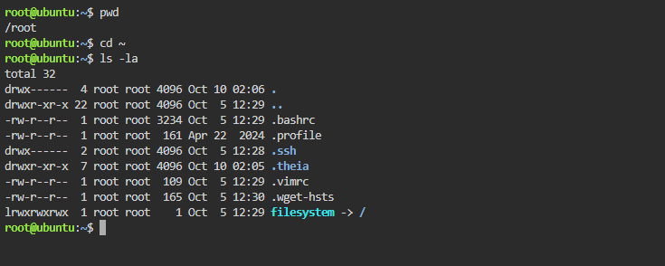
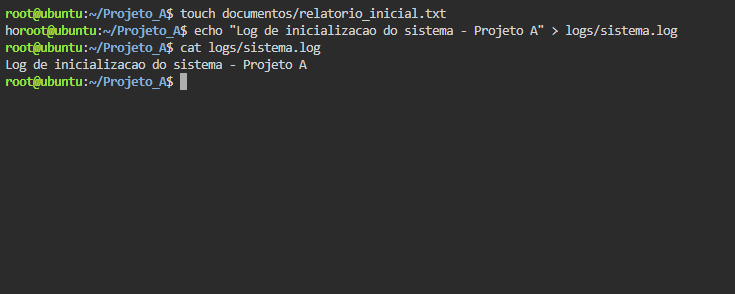
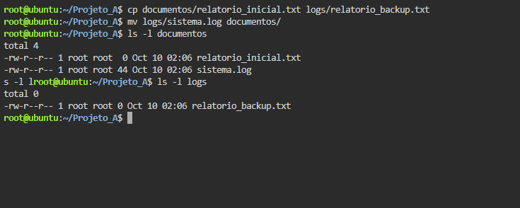
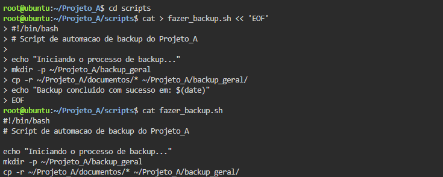

# Atividade 06 - Administração de Arquivos e Diretórios no Linux

Ambiente: Ubuntu 24.04 no [Killercoda](https://killercoda.com/playgrounds/scenario/ubuntu).

Evidências da execução de cada etapa (prints em `evidencias/`).

## Etapa 1 - Navegação e inspeção do ambiente

```bash
pwd
cd ~
ls -la
```



## Etapa 2 - Criação da estrutura de diretórios

```bash
mkdir Projeto_A
cd Projeto_A
mkdir documentos logs scripts
ls -l
```


## Etapa 3 - Criação e edição de arquivos de texto

```bash
touch documentos/relatorio_inicial.txt
echo "Log de inicializacao do sistema - Projeto A" > logs/sistema.log
cat logs/sistema.log
```



## Etapa 4 - Cópia e movimentação de arquivos

```bash
cp documentos/relatorio_inicial.txt logs/relatorio_backup.txt
mv logs/sistema.log documentos/
ls -l documentos
ls -l logs
```



## Etapa 5 - Criação e execução do script Shell

Script `fazer_backup.sh` criado em `scripts/` (via `cat` com heredoc):

```bash
#!/bin/bash
# Script de automacao de backup do Projeto_A

echo "Iniciando o processo de backup..."
mkdir -p ~/Projeto_A/backup_geral
cp -r ~/Projeto_A/documentos/* ~/Projeto_A/backup_geral/
echo "Backup concluido com sucesso em: $(date)"
```



```bash
cd ~/Projeto_A/scripts
chmod +x fazer_backup.sh
./fazer_backup.sh
```


## Etapa 6 - Verificação do backup

```bash
cd ~/Projeto_A/backup_geral
ls -l
```


O diretório `backup_geral` contém as cópias dos arquivos de `documentos`, confirmando o funcionamento da automação.

> Observação: acentos foram omitidos nos textos do `echo` por limitação de digitação no terminal web.
