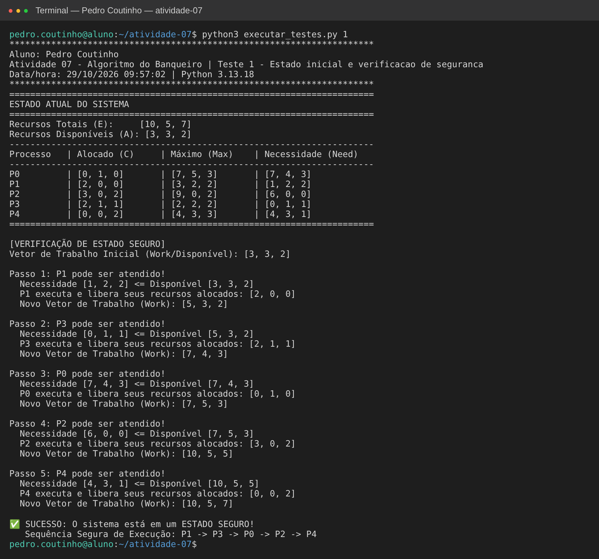
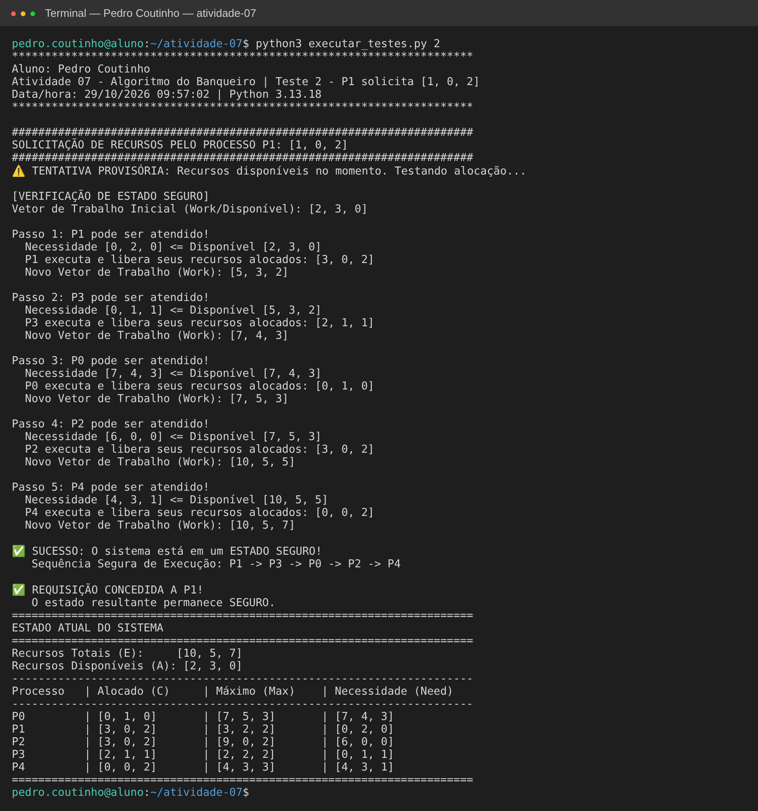
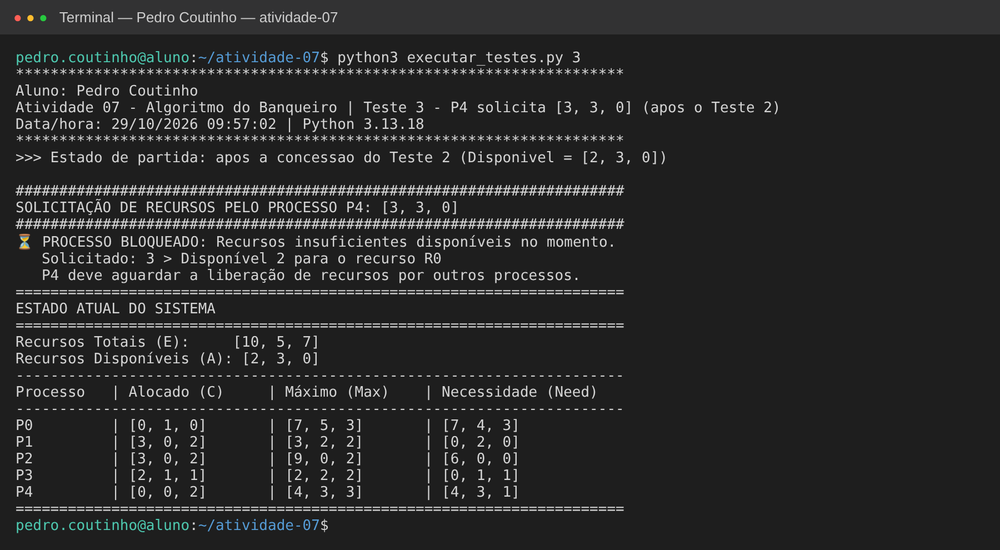

# Atividade 07 – Algoritmo do Banqueiro

**Aluno:** Pedro Coutinho

O Algoritmo do Banqueiro (Dijkstra) evita deadlocks porque só concede um pedido de recursos se o sistema continuar em um **estado seguro**. Estado seguro significa que existe pelo menos uma ordem em que todos os processos conseguem terminar.

## Arquivos

| Arquivo | Conteúdo |
|---|---|
| `bankers_algorithm.py` | Simulador fornecido em aula |
| `executar_testes.py` | Roda cada teste separadamente, com cabeçalho identificando o aluno |
| `evidencias/saida_testeN.txt` | Saída de cada execução em texto |
| `evidencias/testeN-*.png` | Print da execução de cada teste |

Como executar: `python3 executar_testes.py 1` (ou `2`, `3`).

## Cenário inicial

5 processos (P0–P4) e 3 tipos de recursos (R0, R1, R2).

- Recursos totais **E = [10, 5, 7]**
- Disponível **A = E − Σ Alocado = [3, 3, 2]**
- Necessidade **Need = Max − Alocado**

| Processo | Alocado | Máximo | Need |
|---|---|---|---|
| P0 | [0,1,0] | [7,5,3] | [7,4,3] |
| P1 | [2,0,0] | [3,2,2] | [1,2,2] |
| P2 | [3,0,2] | [9,0,2] | [6,0,0] |
| P3 | [2,1,1] | [2,2,2] | [0,1,1] |
| P4 | [0,0,2] | [4,3,3] | [4,3,1] |

---

## Teste 1 – Estado inicial e verificação de segurança

**O que testa:** se o estado inicial é seguro.

**Como funciona:** o algoritmo começa com `Work = Disponível = [3,3,2]` e procura um processo cujo `Need ≤ Work`. Esse processo pode terminar, então devolve o que tem alocado e `Work` aumenta. Isso se repete até todos terminarem ou até nenhum processo poder ser atendido.

**Saída obtida:**

| Passo | Processo | Need ≤ Work | Work depois |
|---|---|---|---|
| 1 | P1 | [1,2,2] ≤ [3,3,2] | [5,3,2] |
| 2 | P3 | [0,1,1] ≤ [5,3,2] | [7,4,3] |
| 3 | P0 | [7,4,3] ≤ [7,4,3] | [7,5,3] |
| 4 | P2 | [6,0,0] ≤ [7,5,3] | [10,5,5] |
| 5 | P4 | [4,3,1] ≤ [10,5,5] | [10,5,7] |

**Resultado:** ✅ **estado SEGURO**, com a sequência **P1 → P3 → P0 → P2 → P4**. No fim, `Work` volta a ser igual a E, ou seja, todos os recursos foram devolvidos.

---

## Teste 2 – P1 solicita [1, 0, 2]

**O que testa:** um pedido válido que deve ser concedido.

**Verificações feitas pelo algoritmo:**
1. **Pedido ≤ Need?** [1,0,2] ≤ [1,2,2] ✔ (P1 não pede mais do que declarou)
2. **Pedido ≤ Disponível?** [1,0,2] ≤ [3,3,2] ✔ (há recursos livres)
3. **Alocação provisória:** Disponível passa a [2,3,0], Alocado(P1) passa a [3,0,2] e Need(P1) passa a [0,2,0].
4. **Teste de segurança no novo estado:** P1 consegue terminar primeiro ([0,2,0] ≤ [2,3,0]) e encontra-se a sequência **P1 → P3 → P0 → P2 → P4**.

**Resultado:** ✅ **REQUISIÇÃO CONCEDIDA.** O estado continua seguro, então a alocação é confirmada. A tabela final mostra Disponível = [2,3,0].

---

## Teste 3 – P4 solicita [3, 3, 0] (após o Teste 2)

**O que testa:** um pedido feito quando não há recursos suficientes.

**Estado de partida:** o estado resultante do Teste 2 (Disponível = [2,3,0]).

**Verificações feitas pelo algoritmo:**
1. **Pedido ≤ Need?** [3,3,0] ≤ [4,3,1] ✔
2. **Pedido ≤ Disponível?** R0: 3 > 2 ✘

**Resultado:** ⏳ **PROCESSO BLOQUEADO.** Faltam recursos agora (só há 2 unidades de R0), então P4 precisa esperar outros processos liberarem recursos. Como o pedido para no passo 2, nem a alocação provisória nem o teste de segurança chegam a rodar, e o estado do sistema continua o mesmo.

> Observação: no código, este caso aparece como "requisição insegura", mas a negação acontece antes da verificação de segurança, porque não há recursos disponíveis. Se fosse aplicado direto ao estado inicial (Disponível [3,3,2]), o pedido passaria pelo passo 2 e deixaria Disponível = [0,0,2]. Nesse estado nenhum processo conseguiria terminar, então o pedido seria negado por **estado inseguro**.

---

## Conclusão

| Teste | Situação | Resultado |
|---|---|---|
| 1 | Estado inicial | Seguro: P1 → P3 → P0 → P2 → P4 |
| 2 | P1 pede [1,0,2] | Concedido (estado continua seguro) |
| 3 | P4 pede [3,3,0] | Bloqueado (faltam recursos de R0) |

O Algoritmo do Banqueiro só aceita pedidos que mantêm o sistema em estado seguro. Assim, o deadlock é evitado antes de acontecer, em vez de ser detectado depois.
